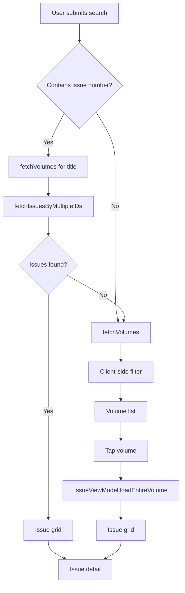

# Product Predictor — Reference Documentation

Reference guide for returning to the **Collectibles** iOS app after time away. The repo is named `product-predictor`; the Xcode target is `pricepredictor`.

---

## What This App Does

A native **SwiftUI** comic collectibles browser backed by the [Comic Vine API](https://comicvine.gamespot.com/api/). Users can:

1. **Search** by series title (e.g. `"batman"`) or title + issue number (e.g. `"batman 423"`)
2. **Browse volumes** (comic series) matching a title
3. **View all issues** in a volume as a grid
4. **Open issue detail** — cover art, credits, and description

**Not yet implemented:** Despite the project name, there is **no price prediction or pricing data** today. Issue detail is the intended home for pricing and variant data later.

---

## Quick Start

### Prerequisites

- Xcode 26.2+ (project targets iOS 26.2)
- A Comic Vine API key from https://comicvine.gamespot.com/api/

### Setup

```bash
cd product-predictor
cp Secrets.example.xcconfig Secrets.xcconfig
# Edit Secrets.xcconfig and set COMIC_VINE_API_KEY = your_key_here
```

Open `pricepredictor.xcodeproj`, select the **pricepredictor** scheme, choose an iOS Simulator, and run (⌘R).

### Command-line build

```bash
xcodebuild -project pricepredictor.xcodeproj \
  -scheme pricepredictor \
  -destination 'platform=iOS Simulator,name=iPhone 16' \
  build
```

---

## Architecture Overview

Lightweight **MVVM** with a service layer. No third-party dependencies.

```
Views (SwiftUI)
    ↕ @State / @Observable
ViewModels (SearchViewModel, IssueViewModel)
    ↕ async/await
ProductService (Comic Vine API client)
    ↕ HTTPS JSON
Comic Vine API
```

### Tech stack

| Layer | Choice |
|-------|--------|
| Language | Swift 5 |
| UI | SwiftUI |
| State | `@Observable`, `@State` |
| Networking | `URLSession` |
| Concurrency | `async`/`await`, `Task` |
| Persistence | None |
| Dependencies | None (no SPM packages) |

---

## User Flows

### Title-only search

```
"batman"
  → SearchViewModel.performSmartSearch
  → ProductService.fetchVolumes
  → Client-side filter (condensed string matching)
  → Volume list → tap volume → Issue grid → tap issue → Issue detail
```

### Smart search (title + issue number)

```
"batman 423"
  → String.partitionTitleAndIssue() → ("batman", "423")
  → fetchVolumes("batman")
  → fetchIssuesByMultipleIDs(ids: "123|456|...", issueNumber: "423")
  → If issues found: issue grid
  → If no issues: fallback to volume list for "batman"
```



---

## Project Structure

```
product-predictor/
├── Config/
│   └── App.xcconfig              # Base config; injects API key into Info.plist
├── Secrets.example.xcconfig      # Template for local secrets
├── Secrets.xcconfig              # Local API key (gitignored)
├── docs/
│   └── REFERENCE.md              # This file
├── pricepredictor/               # Main app (auto-synced by Xcode)
│   ├── pricepredictorApp.swift   # @main entry point
│   ├── ContentView.swift         # Thin wrapper → GlobalSearchResults
│   ├── Models/
│   │   └── Volumes.swift         # ComicResponse, Volumes, ComicIssues
│   ├── Services/
│   │   └── ProductService.swift  # Comic Vine API client
│   ├── ViewModels/
│   │   ├── SearchViewModel.swift # Search orchestration, volume filtering
│   │   └── IssueViewModel.swift  # Issue pagination, dedup, sorting
│   ├── Views/
│   │   ├── GlobalSearchResults.swift   # Primary search UI
│   │   ├── VolumeIssuesDetailView.swift
│   │   ├── IssueDetailView.swift
│   │   ├── ProductRow.swift            # Reusable list/grid row
│   │   └── UIComponents.swift
│   └── Extensions/
│       └── String+Extension.swift      # Search string parsing
├── pricepredictorTests/          # Unit test target (boilerplate only)
├── pricepredictorUITests/        # UI test target (boilerplate only)
└── pricepredictor.xcodeproj/
```

**Note:** Xcode uses `PBXFileSystemSynchronizedRootGroup` — files added under `pricepredictor/` are picked up automatically. Folders outside the sync groups (`Utilities/`, `Configurations/`) are **not compiled**.

---

## Key Files

| Purpose | Path |
|---------|------|
| App entry | `pricepredictor/pricepredictorApp.swift` |
| Main search UI | `pricepredictor/Views/GlobalSearchResults.swift` |
| API client | `pricepredictor/Services/ProductService.swift` |
| Data models | `pricepredictor/Models/Volumes.swift` |
| Search logic | `pricepredictor/ViewModels/SearchViewModel.swift` |
| Issue pagination | `pricepredictor/ViewModels/IssueViewModel.swift` |
| String parsing | `pricepredictor/Extensions/String+Extension.swift` |
| Secrets template | `Secrets.example.xcconfig` |
| Build config | `Config/App.xcconfig` |
| Shared scheme | `pricepredictor.xcodeproj/xcshareddata/xcschemes/pricepredictor.xcscheme` |

---

## Models

Defined in `pricepredictor/Models/Volumes.swift`.

| Type | Role |
|------|------|
| `ComicResponse<T>` | Generic API envelope (`offset`, `number_of_total_results`, `results`) |
| `Volumes` | Comic series — `id`, `name`, `start_year`, `count_of_issues`, `image` |
| `ComicIssues` | Single issue — credits, dates, description, `site_detail_url` |
| `ImageLinks` | Cover image URLs (`small_url`, `screen_url`) |

**Helpers on `ComicIssues`:** `sortableNumber` (handles fractional issues like `1/2`), `sortingDate`, `displayLabel`.

**Protocol:** `ComicDisplayable` in `ProductRow.swift` lets one row component render both volumes and issues in list or grid layout.

---

## Services — ProductService

Central API client in `pricepredictor/Services/ProductService.swift`.

| Method | Endpoint | Used for |
|--------|----------|----------|
| `fetchVolumes(for:)` | `GET /api/volumes/?filter=name:…` | Series search |
| `fetchVolumeIssues(for:offset:)` | `GET /api/issues/?filter=volume:ID` | Paginated issues in a volume |
| `fetchIssuesByMultipleIDs(ids:issueNumber:)` | `GET /api/issues/?filter=volume:ID1\|ID2\|…` | Smart search across candidate volumes |
| `fetchSpecificIssues(title:issueNumber:)` | Legacy path | Present but superseded by multi-ID fetch |
| `fetchIssuesByVolumeID(id:issueNumber:)` | Single-volume issue lookup | Present but less used |

`performRequest<T>()` handles HTTP status codes (200, 401/403, 429) and JSON decoding. Some older methods bypass it and use raw `URLSession` without status checks.

**Comic Vine conventions used:**
- `filter` param for resource queries
- `field_list` to limit payload size
- `offset` / `limit` / `sort` for pagination

---

## ViewModels

### SearchViewModel

The "generalist" — owns the search bar state and decides which result mode to show.

| Property / method | Role |
|-------------------|------|
| `performSmartSearch(input:)` | Routes title-only vs title+issue searches |
| `loadVolumeData(for:)` | Fetches volumes + client-side token filtering |
| `resultMode` | `.volumes` or `.issues` |
| `issueVM` | Nested `IssueViewModel` for issue results |
| `products` | Filtered volume list |

### IssueViewModel

The "specialist" — handles issue lists with pagination.

| Property / method | Role |
|-------------------|------|
| `loadEntireVolume(for:)` | Paginated fetch loop with dedup + numeric sort |
| `loadBulkIssues(ids:number:)` | Smart-search issue resolution |
| `executeFetch` | Pagination engine (`limit = 100`) |

**Sorting note:** Comic Vine sorts `issue_number` as strings. The client re-sorts numerically using `sortableNumber`.

---

## Views

| View | Screen |
|------|--------|
| `GlobalSearchResults` | Main search bar, volume list / issue grid switcher |
| `VolumeIssuesDetailView` | All issues in one volume (grid, local filter, pull-to-refresh) |
| `IssueDetailView` | Cover, title, date, creative team, HTML-stripped description |
| `ProductRow` | Reusable row via `ComicDisplayable` |
| `ContentView` | Delegates to `GlobalSearchResults()` |

**Navigation:** `GlobalSearchResults` uses value-based `NavigationStack` destinations (`Volumes.self`, `ComicIssues.self`). `VolumeIssuesDetailView` still uses `NavigationLink(destination:)` — inconsistent if you add deep linking later.

---

## String Extensions

`pricepredictor/Extensions/String+Extension.swift` powers search parsing:

| Extension | Example |
|-----------|---------|
| `sanitized` | Lowercase, strip stop words (`"the"`, `"of"`, etc.) |
| `condensed` | Alphanumeric only — `"Spider-Man"` → `"spiderman"` |
| `partitionTitleAndIssue()` | `"batman 423"` → `("batman", "423")` |

The **condensed sieve** in `SearchViewModel.loadVolumeData` filters API volume results so `"Spider-Man"` matches `"spiderman"` in volume names.

---

## Configuration & Secrets

### API key resolution chain

1. **`Secrets.xcconfig`** (project root, gitignored) — copy from `Secrets.example.xcconfig`
2. **`Config/App.xcconfig`** includes it and injects into Info.plist:
   ```
   INFOPLIST_KEY_COMIC_VINE_API_KEY = $(COMIC_VINE_API_KEY)
   ```
3. **Runtime** in `ProductService.Secrets.apiKey`:
   - `Bundle.main` Info.plist key `COMIC_VINE_API_KEY`
   - OR `ProcessInfo.processInfo.environment["COMIC_VINE_API_KEY"]`
   - `fatalError` if missing or empty

### SwiftUI Previews gotcha

Previews use a **different bundle** than the running app. Set `COMIC_VINE_API_KEY` in the **Run scheme Environment Variables** (configured in the shared scheme) or previews will crash on `fatalError`.

### Security

Do not commit real API keys. If a key was ever committed to a public repo, rotate it at Comic Vine.

---

## Testing

| Target | Status |
|--------|--------|
| `pricepredictorTests` | Xcode template only — no real unit tests yet |
| `pricepredictorUITests` | Launch + screenshot boilerplate |

Run tests in Xcode with ⌘U, or:

```bash
xcodebuild test -project pricepredictor.xcodeproj -scheme pricepredictor \
  -destination 'platform=iOS Simulator,name=iPhone 16'
```

No CI/CD workflows are configured.

---

## Known Gaps & Gotchas

### Incomplete / unused code

| Item | Location | Issue |
|------|----------|-------|
| `lastSubmittedSearch` | `SearchViewModel` | Never assigned — "Results for …" header never shows |
| `showFallbackMessage` | `SearchViewModel` | Declared but unused |
| `siteDetailUrl` | `ComicIssues` model | Parsed but no "View on ComicVine" button in UI |
| `ComicHeader` | `UIComponents.swift` | Defined but not referenced |
| `searchIssuesURL` | `ProductService.APIConfig` | Defined but unused |

### Bugs / inconsistencies

1. **Pagination mismatch:** `IssueViewModel.limit = 100` but API default `limit = 200` — offset increments by 100 while API may return up to 200 per page (risk of skipped pages on large volumes).
2. **Inconsistent error handling:** Some `ProductService` methods skip `performRequest` and don't handle HTTP errors or rate limits.
3. **Mixed navigation styles:** Value-based vs destination-based `NavigationLink` across views.
4. **`ResponseError.errorDecription`** — typo (not `localizedDescription`); errors may not display correctly in alerts.
5. **No caching** — every navigation refetches from Comic Vine (429 handling exists but no retry/backoff).
6. **Double loading flag:** `performSmartSearch` and `loadVolumeData` both set `isLoading`.

### Orphan folders (not in Xcode target)

- `Utilities/Extensions/String+Extensions.swift` — empty duplicate
- `Configurations/Secrets/Secrets.plist` — empty stub

---

## Roadmap Hints

Based on code comments and naming, likely next steps:

- **Price prediction** — the original project goal; no implementation yet
- **Issue variants & pricing** — intended for `IssueDetailView`
- **"View on ComicVine" link** — `siteDetailUrl` already parsed on the model
- **Tests** — unit tests for string parsing, view model logic, and API response decoding
- **Caching** — reduce Comic Vine rate-limit exposure
- **Unified navigation** — migrate `VolumeIssuesDetailView` to value-based destinations

---

## IDE / Tooling Notes

- **`buildServer.json`** configures `xcode-build-server` for Cursor/LSP. Verify the `workspace` path matches your local checkout location.
- **Bundle ID:** `com.codejelly.pricepredictor`
- **Remote:** https://github.com/codejelly/product-predictor.git

---

## Git Context

Recent work (merged PR `KAN-11_base_code`) added smart search, issue detail view, volume/issue layout split, and the versatile `ProductRow`. The app is early-stage — core browse/search works; pricing and polish are ahead.
